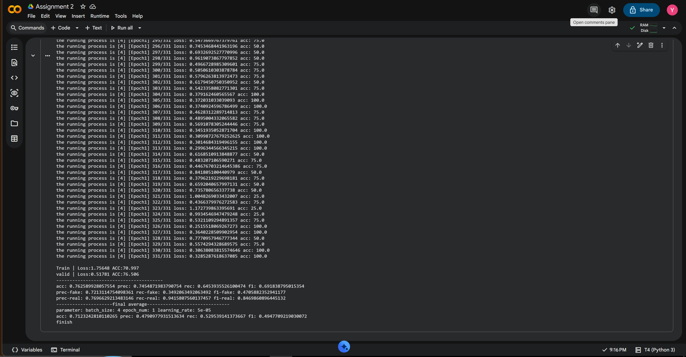

# Dual-Inconsistency Rumor Detection Network — Colab Adaptation

This repository contains an adapted implementation based on the code associated with:

**Inconsistency Matters: A Knowledge-guided Dual-inconsistency Network for Multi-modal Rumor Detection**  
Sun Mengzhu, Zhang Xi, Ma Jianqiang, Liu Yazheng — Findings of EMNLP 2021.

Paper: https://aclanthology.org/2021.findings-emnlp.122/

## Important reproducibility note

The original implementation expects the authors' pretrained 50-dimensional Freebase TransE embeddings and the matching Freebase entity dictionary. Those pretrained files were not available in this assignment environment.

For this Colab adaptation, the entity vectors are generated from entity co-occurrence in the filtered PHEME CSV using positive pointwise mutual information (PPMI) and truncated singular value decomposition (SVD) to 50 dimensions.

**These PPMI/SVD vectors are not the original Freebase TransE embeddings.** Results from this adapted setup must not be presented as an exact reproduction of the paper's experiments.

The historical tweet images are also incomplete. The current filtered dataset contains only records for which an image was successfully recovered and validated.

## Dataset preparation

The original CSV in `data/pheme_final_fb.csv` contains 2,374 records. In the preparation run for this assignment:
- Original CSV records: 2,374
- Records retained after validating image files: 2,069
- Rows excluded because their referenced images were unavailable: 305
- Distinct missing image IDs: 275

The filtered CSV is stored at `data/pheme/pheme_final_fb.csv`.

Image files are expected at `data/pheme/images/<image_id>.jpg`.

Do not claim that the excluded records were used in training.

## Runtime

The project is adapted for a Google Colab runtime with an NVIDIA T4 GPU. GPU availability and runtime limits depend on Colab.

The original repository lists Python 3.6, PyTorch 1.4.0, Transformers 4.9.1 and NLTK. This adaptation uses the active Colab PyTorch/torchvision installation and a locally downloaded BERT model.

## Required resources (kept outside GitHub)

The large/runtime resources are kept in Google Drive or the Colab runtime rather than committed to this repository:

- BERT-base-uncased model files under `bert-base-uncased/`
- PHEME images under `data/pheme/images/`
- Dataset-derived vectors under `data_derived/entity_cooccurrence/`

The embedding directory must contain:
- `entity2vec.bin`: row-major float32 vectors with 50 dimensions per entity
- `entity2id.txt`: first line is the entity count; remaining lines are `entity_id<TAB>integer_index`

## Generate the dataset-derived vectors

Run the Colab preparation cell that:
1. Reads `data/pheme/pheme_final_fb.csv`
2. Builds an entity co-occurrence matrix from the entity lists
3. Computes PPMI
4. Applies TruncatedSVD with 50 components
5. Saves the two files under `data_derived/entity_cooccurrence/`

Copy or link that directory into the project root before training.

## Run

From the project root, enter the model folder:

```bash
cd model
python train.py --dataset pheme --model inconsistency --cuda 0 --epoch 1 --lr 0.00005 --lambda_orth 1.5 --batch 4
```

The command above is an initial training test only. The program uses five folds, so even one epoch runs across all five folds. Increase epochs only after confirming the environment, available runtime, and memory usage.

## Evaluation

The training script writes fold test metrics and prints final averaged accuracy, precision, recall, and F1. Report only values produced by an actual run.

## Model Training Output

The model was trained and evaluated using Google Colab.

### Training Configuration

- Dataset: PHEME
- Model: Dual-Inconsistency
- Batch size: 4
- Epochs: 1
- Learning rate: 0.00005
- Evaluation: 5-fold cross-validation

### Final Training Output

The training process completed successfully.



Note: This is an adapted implementation using PPMI/SVD entity embeddings because the original pretrained Freebase resources were unavailable.

## Project structure

```
Assignment-2/
├── Final_Output.png
├── README.md
├── data/
│   └── pheme_final_fb.csv
├── model/
└── process/
```

## Citation

If you use the original model design, cite:

```bibtex
@inproceedings{sun-etal-2021-inconsistency-matters,
  title = "Inconsistency Matters: A Knowledge-guided Dual-inconsistency Network for Multi-modal Rumor Detection",
  author = "Sun, Mengzhu and Zhang, Xi and Ma, Jianqiang and Liu, Yazheng",
  booktitle = "Findings of the Association for Computational Linguistics: EMNLP 2021",
  year = "2021",
  pages = "1412--1423",
  url = "https://aclanthology.org/2021.findings-emnlp.122"
}
```
